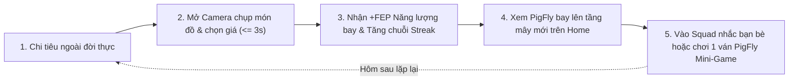

# 🎮 ĐẶC TẢ TÍNH NĂNG: PIGFLY GAMIFICATION ENGINE (MINI-GAME HEO BAY)

> **Mô-đun:** Gamification & Mini-game Heo Bay  
> **Trạng thái:** NEW Specification (Sẵn sàng triển khai theo lộ trình mới)  
> **Áp dụng cho:** Toàn bộ hệ sinh thái PigFly (Home, Stats, Chat Squad và Mini-Game độc lập)

---

## 🌟 1. TRIẾT LÝ GAME HÓA & ĐỘNG LỰC NGƯỜI DÙNG

### 1.1. Nghịch Lý Của Ứng Dụng Tài Chính
Phần lớn người dùng tải app quản lý chi tiêu nhưng bỏ cuộc sau vài ngày vì:
* Cảm giác tội lỗi khi nhìn thấy số tiền vơi đi.
* Ứng dụng quá nghiêm túc và mang tính trừng phạt (Negative Feedback).

### 1.2. Giải Pháp "Heo Bay" Của PigFly (Positive Reinforcement)
* **Luật Heo Bay cốt lõi:** *"Tiết kiệm kỷ luật $\rightarrow$ Heo nhẹ gánh $\rightarrow$ Vỗ cánh bay cao"*.
* Khi người dùng giữ mức chi tiêu trong ngày $\le$ hạn mức `Hôm nay tiêu được`, chú heo PigFly trở nên nhẹ nhõm, đôi cánh thiên thần nhỏ vỗ mạnh mẽ và bay lên các tầng mây cao hơn.
* Nếu chi tiêu vượt hạn mức (Overspending), heo sẽ nặng nề rơi xuống và ôm đầu lo lắng nhẹ nhàng, không trừng phạt mà chỉ nhắc nhở tích cực.
* **Mini-Game giải trí:** Tích hợp trực tiếp một mini-game vui nhộn để người dùng mở app xả stress mỗi ngày mà không cảm thấy áp lực tiền bạc.

---

## ⚡ 2. HỆ THỐNG NĂNG LƯỢNG BAY (FLY ENERGY POINTS - FEP)

### 2.1. Cách Thức Tích Lũy Điểm Năng Lượng
Mọi hành vi tài chính lành mạnh trong thế giới thực đều được quy đổi thành Điểm Năng Lượng Bay (FEP):

| Hành vi thực tế trong App | Điểm Năng Lượng (FEP) | Giới hạn |
|:---|:---:|:---|
| **Ghi chép giao dịch trong ngày ($\le 3$s)** | `+30 FEP` / lần | Tối đa 3 lần / ngày (90 FEP) |
| **Giữ vững hạn mức ngày (Không bội chi)** | `+100 FEP` / ngày | Kết toán vào 00:00 mỗi đêm |
| **Duy trì chuỗi Streak liên tiếp** | Nhân hệ số thưởng | Ngày 3 ($\times 1.2$), Ngày 7 ($\times 1.5$), Ngày 30 ($\times 2.0$) |
| **Tương tác nhóm Squad Nuôi Heo** | `+15 FEP` / lần | Nhắc đói hoặc vỗ béo bạn bè |
| **Hoàn thành bài học tài chính 1 phút** | `+50 FEP` / bài | 1 lần cho mỗi bài học mới |

### 2.2. Xử Lý Khi Bội Chi (Negative Balance Protection)
* Khi chi tiêu vượt hạn mức ngày: **KHÔNG TRỪ ĐIỂM FEP ĐÃ TÍCH LŨY** (tránh làm người dùng ức chế bỏ app).
* Thay vào đó, tốc độ hồi phục năng lượng ngày hôm sau giảm $20\%$ cho đến khi người dùng cân bằng lại số dư qua thuật toán Rollover.

---

## ☁️ 3. HỆ THỐNG 5 TẦNG MÂY TÀI CHÍNH (FINANCIAL CLOUD TIERS)

Độ cao bay của PigFly phản ánh sức khỏe tài chính và độ kỷ luật của người dùng:

```
▲ [TẦNG 5] Tự Do Tài Chính (Streak 90+ ngày) ─── Heo mang Vương miện & Cánh Thần Kim Cương
│
▲ [TẦNG 4] Mây Cầu Vồng Thịnh Vượng (Streak 45 ngày) ── Heo có Hào quang & Cánh Thiên thần
│
▲ [TẦNG 3] Mây Vàng Kỷ Luật (Streak 21 ngày) ──────── Heo đeo Balo phản lực Pastel
│
▲ [TẦNG 2] Mây Xanh Tích Lũy (Streak 7 ngày) ──────── Heo đeo Kính phi công Vintage
│
▲ [TẦNG 1] Mây Non Lơ Lửng (Streak 3 ngày) ────────── Heo đập đôi cánh thiên thần nhỏ xíu
```

---

## 🕹️ 4. ĐẶC TẢ MINI-GAME "PIGFLY: VỖ CÁNH GOM TIỀN" (TAP-TO-FLY)

### 4.1. Cơ Chế Điều Khiển (Gameplay Mechanics)
* **Phong cách:** Tap-to-Fly thư giãn (Casual one-touch physics), chuyển động mượt mà, tốc độ vừa phải, không gây ức chế.
* **Thao tác:** Chạm nhẹ ngón tay vào màn hình để PigFly đập cánh bay lên; thả tay ra heo sẽ lượn từ từ xuống nhờ trọng lực mềm.
* **Thời lượng mỗi ván:** 45 – 90 giây (chuẩn thời gian giải trí ngắn hạn cho Gen Z).

### 4.2. Vật Phẩm & Chướng Ngại Vật Trong Game
1. **Vật phẩm thu thập (Collectibles):**
   * *Đồng Xu Vàng (Golden Coins):* Tăng điểm thưởng trong game.
   * *Búp Cốm Non Làng Vòng:* Hồi phục thể lực và tạo lá chắn bảo vệ trong 5 giây.
   * *Trái Tim Tiết Kiệm:* Cho phép hồi sinh 1 lần nếu chạm chướng ngại vật.
2. **Chướng ngại vật mang tính giáo dục tài chính (Obstacles):**
   * *Cơn Bão "Sale Sập Sàn":* Gió ngược làm chậm tốc độ bay.
   * *Tia Sét "FOMO Theo Trend":* Làm rung lắc màn hình nếu va phải.
   * *Đám Mây Đen "Bội Chi Trà Sữa":* Hạ thấp độ cao của heo.

### 4.3. Phần Thưởng & Hệ Thống Skin Trang Phục (Cosmetics)
Điểm số trong mini-game chỉ dùng để mở khóa các Skin phụ kiện vui nhộn cho chú heo PigFly (không dùng tiền thật mua bán):
* Mũ beret phong cách nghệ sĩ Phố Cổ.
* Kính râm vintage phi công Hà Nội.
* Cánh bướm dạ quang hoặc Balo chong chóng tre.

---

## 🔄 5. VÒNG LẶP HÀNH VI HÀNG NGÀY (DAILY HABIT LOOP)



---

## 💻 6. YÊU CẦU KỸ THUẬT & KIẾN TRÚC MÃ NGUỒN

1. **Hiệu Năng Animation 60FPS:**
   * Sử dụng `react-native-reanimated` v3 và `react-native-gesture-handler`.
   * Tách biệt Game Engine thành các Pure Functions (`src/utils/game/pigFlyPhysics.ts`) để phục vụ Unit Testing độc lập mà không phụ thuộc vào React Component lifecycle.
2. **Lưu Trữ Bền Vững Ngoại Tuyến (Offline-First):**
   * Toàn bộ điểm FEP, Tầng mây và Skin trang phục được lưu trong AsyncStorage (`@pigfly_gamification_v1`) và tự động đồng bộ lên Supabase Cloud khi có kết nối mạng.
3. **Kích Thước Tài Nguyên 3D Nhẹ Nhàng:**
   * Ảnh chú heo PigFly sử dụng định dạng WebP nén chất lượng cao $\le 45$KB, hoặc vector Lottie animation $\le 30$KB để đảm bảo ứng dụng khởi động tức thì $< 1.2$ giây.
