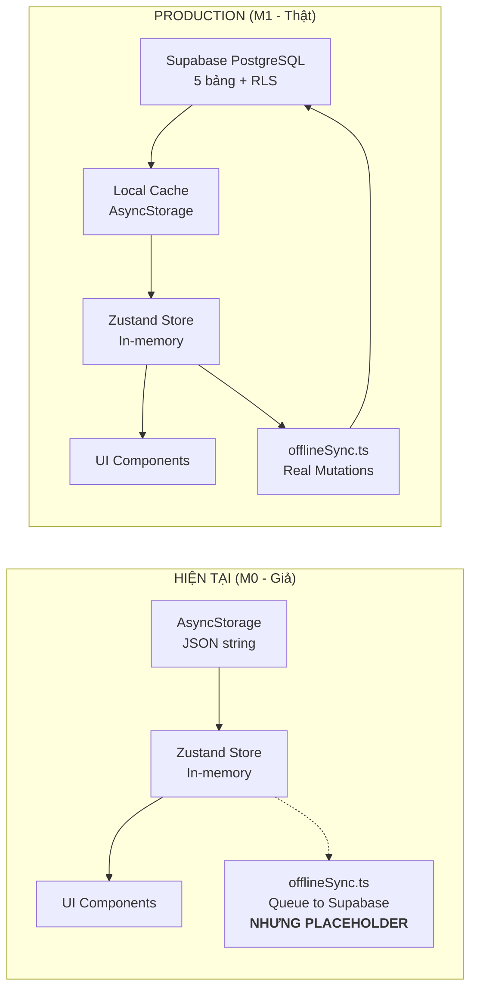
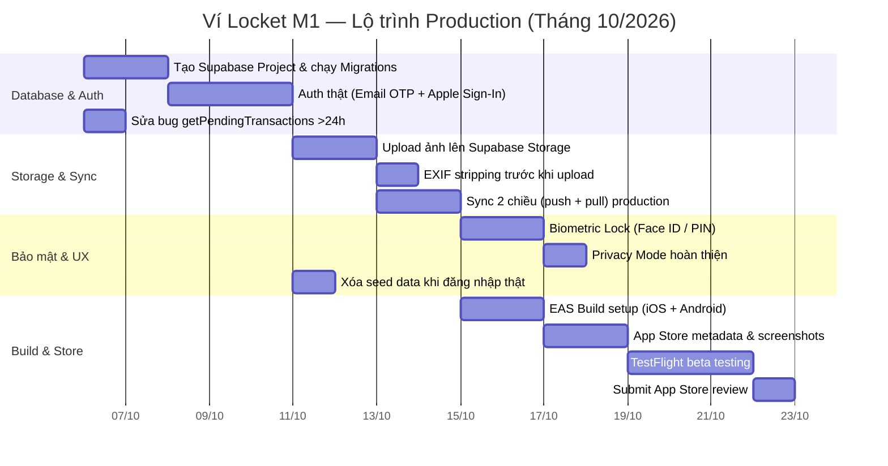

# 🍂 ĐÁNH GIÁ HOÀN THÀNH M0 & KẾ HOẠCH M1 PRODUCTION — VÍ LOCKET

> **Mục đích:** Kiểm kê thật thà M0 đã làm được gì, những gì đang "giả" (hardcode), thiết kế Database thật, và lên kế hoạch M1 để app sẵn sàng lên App Store tháng 10/2026.  
> **Ngày:** 2026-10-05

---

## PHẦN A: KIỂM KÊ M0 — CÁI GÌ THẬT, CÁI GÌ GIẢ?

### ✅ ĐÃ LÀM THẬT (Có code hoạt động)

| # | Tính năng | File chính | Trạng thái |
|---|---|---|---|
| 1 | **Design System Hà Nội Thu Đông** — Bảng màu, font Be Vietnam Pro, FloatingPillTabBar | `src/constants/colors.ts`, `src/theme/` | ✅ Hoạt động |
| 2 | **5 Tab Navigation** — Home, Stats, Camera, Chat, Profile | `app/(main)/_layout.tsx`, `app/(main)/index.tsx` | ✅ Hoạt động |
| 3 | **Camera Photobooth** — Khung ngắm 4:5, nút Shutter, chụp ảnh, lật camera | `app/(main)/index.tsx`, `src/components/camera/` | ✅ Hoạt động |
| 4 | **Giữ mic nói giá (Gemini Voice)** — Giữ Shutter > 400ms, VoiceWaveform, trích xuất giá | `ShutterButton.tsx`, `src/services/gemini.ts` | ✅ Hoạt động (cần Gemini API key) |
| 5 | **Locket Moment Stream** — Cuộn dọc xem ảnh cũ dưới camera | `LocketMomentCard.tsx` | ✅ Hoạt động |
| 6 | **Home / JournalView** — Lịch ảnh 7 cột, thẻ "Hôm nay tiêu được", Rollover | `JournalView.tsx` | ✅ Hoạt động |
| 7 | **Stats / StatsView** — Album ảnh theo tháng, HP Bar | `StatsView.tsx` | ✅ Hoạt động |
| 8 | **Chat / ChatView** — Trò chuyện 2 chiều với Anh Minh qua Gemini AI | `ChatView.tsx`, `minhCoachStore.ts` | ✅ Hoạt động (cần Gemini API key) |
| 9 | **Profile / ProfileView** — Mục tiêu cá nhân, lương giờ, cài đặt | `ProfileView.tsx` | ✅ Hoạt động |
| 10 | **VietQR Scanner (Luồng 1)** — Quét mã EMVCo, parse offline, deeplink mở ngân hàng | `VietQRDetectedCard.tsx`, `src/utils/emvParser.ts` | ✅ Hoạt động |
| 11 | **Pending Return Prompt** — "Đã chuyển xong chưa?" khi quay lại app | `PendingReturnPromptModal.tsx` | ✅ Hoạt động |
| 12 | **Pending Isolation** — Khoản PENDING không tính vào budget/stats | `transactionStore.ts`, `statsUtils.ts` | ✅ Hoạt động |
| 13 | **Offline Sync Queue** — Hàng đợi mutation, flushSyncQueue khi có mạng | `offlineSync.ts` | ✅ Code có, nhưng chưa test thật với Supabase |
| 14 | **Budget Setup Wizard** — 3 bước thiết lập ngân sách | `app/(auth)/` | ✅ Hoạt động |
| 15 | **Upload ảnh từ thư viện** — Chọn ảnh biên lai, ghi nhanh | `expo-image-picker` integration | ✅ Hoạt động |

### ⚠️ ĐANG GIẢ / HARDCORE (Cần chuyển sang Database thật ở M1)

| # | Vấn đề | Hiện trạng | Rủi ro |
|---|---|---|---|
| 1 | **Toàn bộ dữ liệu giao dịch lưu AsyncStorage** | Tất cả transactions serialize JSON vào 1 key `vi_locket_transactions_data` | Giới hạn ~6MB trên iOS AsyncStorage; mất dữ liệu nếu xóa app; không thể query phức tạp |
| 2 | **Budget settings cũng nằm trong AsyncStorage** | Key `vi_locket_budget_data` | Mất khi xóa app, không sync giữa nhiều thiết bị |
| 3 | **Supabase chỉ có placeholder URL** | `supabase.ts` dùng `'https://placeholder.supabase.co'` | Sync queue ghi nhưng KHÔNG THỰC SỰ GỬI lên cloud |
| 4 | **Auth chỉ là Demo User** | `signInWithDemo()` tạo user giả `demo-user-12345` | Không có authentication thật, không có email OTP thật |
| 5 | **Ảnh vẫn dùng URL Unsplash mẫu** | Seed data hardcode link ảnh Unsplash | Ảnh thật chụp từ camera chưa được upload lên Storage |
| 6 | **7 giao dịch seed cứng** | `SEED_TRANSACTIONS` trong `transactionStore.ts` | Mọi user mới đều thấy cùng 7 khoản fake |
| 7 | **Rollover không tính từ DB thật** | `applyRolloverForNewDay` chỉ lấy state hiện tại | Nếu tắt app qua đêm, rollover không chạy |
| 8 | **`getPendingTransactions` bỏ khoản >24h** | Dòng 293: `return now - createdTime < 24 * 3600 * 1000` | **VI PHẠM PRD:** khoản PENDING không bao giờ được biến mất! |
| 9 | **Không có migration runner** | SQL files trong `supabase/migrations/` nhưng chưa chạy trên Supabase instance thật | DB chưa được tạo |
| 10 | **Notifications chưa hoạt động thật** | `expo-notifications` installed nhưng chưa setup push token | Giỏ Chờ không nhắc người dùng |

### 🔴 CHƯA LÀM (Cần cho M1)

| # | Tính năng | Mức độ ưu tiên |
|---|---|---|
| 1 | **Supabase project thật** — URL + Anon Key + chạy migrations | 🔴 Bắt buộc |
| 2 | **Auth thật** — Email OTP / Apple Sign-In / Google Sign-In | 🔴 Bắt buộc (App Store bắt buộc) |
| 3 | **Supabase Storage upload** — Ảnh chụp lên private bucket | 🔴 Bắt buộc |
| 4 | **EXIF stripping thật** — `expo-image-manipulator` xóa metadata | 🟡 Quan trọng (Privacy) |
| 5 | **EAS Build** — Build native iOS/Android IPA/APK | 🔴 Bắt buộc lên App Store |
| 6 | **Biometric Lock** — Face ID / Touch ID / PIN | 🟡 Quan trọng (App tài chính) |
| 7 | **Export dữ liệu** — CSV/PDF cuối tháng | 🟢 Nên có |
| 8 | **Deep link callback** — `vilocket://auth-callback` | 🔴 Bắt buộc cho auth flow |
| 9 | **App Store metadata** — Screenshots, description, privacy manifest | 🔴 Bắt buộc |
| 10 | **Error tracking** — Sentry / Crashlytics | 🟡 Quan trọng |

---

## PHẦN B: THIẾT KẾ DATABASE — CÂU HỎI CẦN THỐNG NHẤT VỚI CHỦ DỰ ÁN

> [!IMPORTANT]
> Đây là phần quan trọng nhất mà trước giờ Agent chưa bao giờ hỏi. Mọi quyết định ở đây ảnh hưởng trực tiếp đến việc app có mất dữ liệu người dùng hay không.

### B.1. Kiến trúc dữ liệu hiện tại vs. Production



### B.2. Schema Database đã thiết kế (2 migrations sẵn)

| Bảng | Cột chính | RLS | Migration |
|---|---|---|---|
| `profiles` | `id (UUID PK)`, `email`, `full_name`, `birthdate`, `fav_unit`, `hourly_rate`, `privacy_mode` | ✅ User chỉ xem mình | `001` |
| `financial_settings` | `user_id`, `monthly_income`, `monthly_fixed_costs`, `goal_name`, `goal_target_amount`, `base_daily_budget` | ✅ | `001` |
| `transactions` | `user_id`, `type`, `amount`, `category`, `description`, `photo_url`, `payment_method`, `source`, `status`, `payee_name`, `bank_bin`, `qr_kind`, `pending_expires_at` | ✅ | `001` + `002` |
| `wait_basket` | `user_id`, `item_name`, `amount`, `status (WAITING/BOUGHT/SKIPPED)`, `remind_interval_hours`, `next_remind_at` | ✅ | `001` |
| `daily_budget_logs` | `user_id`, `log_date`, `allocated_budget`, `actual_spent`, `rollover_amount` | ✅ | `001` |
| **Storage Bucket** | `item-photos` — Private, chỉ owner xem/upload | ✅ RLS | `001` |

### B.3. Những câu hỏi cần quyết định

> [!CAUTION]
> Các câu hỏi dưới đây cần chủ dự án trả lời trước khi bắt tay vào M1.

**Q1. Supabase Project:**
- Anh đã tạo Supabase project chưa? Nếu chưa, Agent sẽ hướng dẫn từng bước tạo trên [supabase.com](https://supabase.com).
- Cần: `SUPABASE_URL` và `SUPABASE_ANON_KEY` để điền vào `.env`.

**Q2. Authentication cho App Store:**
- Apple **bắt buộc** có Apple Sign-In nếu app có bất kỳ Social Login nào.
- Phương án đề xuất: **Email OTP** (có sẵn trong code) + **Apple Sign-In** (bắt buộc cho iOS).
- Google Sign-In: Tùy chọn thêm cho Android.

**Q3. Ảnh lưu ở đâu?**
- **Phương án A (Khuyến nghị):** Supabase Storage — Private bucket, AES-256, mỗi user 1 folder. Giới hạn 1GB free/project.
- **Phương án B:** Chỉ lưu local (`expo-file-system`), không backup lên cloud. Mất ảnh khi xóa app.

**Q4. Dữ liệu cũ (demo) khi user đăng ký thật:**
- Giữ lại 7 khoản seed cho user thử nghiệm? Hay xóa sạch khi đăng nhập thật?

**Q5. Giới hạn ảnh:**
- 1 giao dịch = 1 ảnh hay nhiều ảnh?
- Chất lượng ảnh: 1080px WebP (hiện tại ~150KB/ảnh) → 1GB free = ~6,800 ảnh/user.
- Có cần ảnh thumbnail riêng trên cloud hay tạo on-the-fly?

**Q6. Export dữ liệu:**
- Ở M1 hay để M2?
- Định dạng: CSV, PDF, hoặc cả hai?

---

## PHẦN C: KẾ HOẠCH M1 — TỪ DEMO ĐẾN PRODUCTION

### Tầm nhìn: Tháng 10 lên App Store



### C.1. Phase M1-DB: Database Production (2 ngày)

| Task | Chi tiết | File ảnh hưởng |
|---|---|---|
| M1-DB.1 | Tạo Supabase project trên supabase.com | `.env` |
| M1-DB.2 | Chạy `001_initial_schema.sql` + `002_vietqr_status_and_metadata.sql` | Supabase SQL Editor |
| M1-DB.3 | Thêm cột `privacy_mode BOOLEAN DEFAULT false` vào `profiles` | Migration `003` |
| M1-DB.4 | Thêm cột `thumbnail_url TEXT` vào `transactions` | Migration `003` |
| M1-DB.5 | Cập nhật source CHECK: thêm `'PHOTO'`, `'QR'` vào danh sách | Migration `003` |
| M1-DB.6 | Verify RLS policies hoạt động đúng | Supabase Dashboard |

### C.2. Phase M1-Auth: Authentication Thật (3 ngày)

| Task | Chi tiết |
|---|---|
| M1-Auth.1 | Bật Email OTP trong Supabase Auth settings |
| M1-Auth.2 | Cấu hình Apple Sign-In (cần Apple Developer Account $99/năm) |
| M1-Auth.3 | Sửa `authStore.ts`: Xóa `signInWithDemo` flow, thay bằng auth thật |
| M1-Auth.4 | Thiết kế màn Onboarding (lần đầu mở app) + Login screen |
| M1-Auth.5 | Xử lý `vilocket://auth-callback` deep link |
| M1-Auth.6 | Migrate dữ liệu demo sang user thật (hàm `migrateGuestDataToUser` đã có) |

### C.3. Phase M1-Storage: Ảnh lên Cloud (2 ngày)

| Task | Chi tiết |
|---|---|
| M1-Storage.1 | Sửa `imageOptimizer.ts`: Nén WebP 1080px + thumbnail 240px |
| M1-Storage.2 | Upload vào Supabase Storage bucket `item-photos/{userId}/{txId}.webp` |
| M1-Storage.3 | Strip EXIF metadata trước khi upload (`expo-image-manipulator`) |
| M1-Storage.4 | Cập nhật `photo_url` trong transaction thành Supabase Storage URL |
| M1-Storage.5 | Cache ảnh local bằng `expo-image` (LRU 30 ngày) |

### C.4. Phase M1-Sync: Đồng bộ Production (2 ngày)

| Task | Chi tiết |
|---|---|
| M1-Sync.1 | `offlineSync.ts` → Kết nối Supabase thật, test push mutations |
| M1-Sync.2 | `syncDownTransactions` → Pull từ server, merge Last-Writer-Wins |
| M1-Sync.3 | Xử lý xung đột: Cùng transaction sửa trên 2 thiết bị |
| M1-Sync.4 | Realtime subscription (Supabase Realtime) cho multi-device |

### C.5. Phase M1-Security: Bảo mật (2 ngày)

| Task | Chi tiết |
|---|---|
| M1-Sec.1 | Biometric Lock: `expo-local-authentication` — Face ID / Fingerprint / PIN |
| M1-Sec.2 | Secure Storage: `expo-secure-store` cho tokens thay vì AsyncStorage |
| M1-Sec.3 | Privacy Mode: Blur ảnh + ẩn số tiền khi bật |
| M1-Sec.4 | Audit: Verify logs không chứa account numbers (đã có test) |

### C.6. Phase M1-Build: App Store (5 ngày)

| Task | Chi tiết |
|---|---|
| M1-Build.1 | Setup EAS Build: `eas.json`, provisioning profiles |
| M1-Build.2 | `app.json` → Bundle ID, version, permissions text |
| M1-Build.3 | App Store Connect: Metadata, screenshots (6.7" + 5.5" iPhone) |
| M1-Build.4 | Privacy Manifest (Apple requirement 2024+) |
| M1-Build.5 | TestFlight beta → Internal testing |
| M1-Build.6 | Submit for App Store Review |
| M1-Build.7 | Google Play Console: Listing + AAB upload |

---

## PHẦN D: BUG CRITICAL CẦN SỬA NGAY

### 🔴 Bug #1: Khoản PENDING biến mất sau 24h

**File:** [transactionStore.ts](file:///c:/Users/TanPhat/Documents/AI_E/Ví-Locket/src/store/transactionStore.ts#L288-L296)

```diff
getPendingTransactions: () => {
-  const now = Date.now();
  return get().transactions.filter((t) => {
-    if (t.status !== 'PENDING') return false;
-    // Kiểm tra quá 24h
-    const createdTime = new Date(t.created_at).getTime();
-    return now - createdTime < 24 * 3600 * 1000;
+    return t.status === 'PENDING';
  });
},
```

**Lý do:** PRD quy định rõ *"Khoản PENDING (Luồng 1) KHÔNG BAO GIỜ TỰ BIẾN MẤT sau 24h"*. Khoản quá 24h phải vào mục "Chưa xác nhận" — vẫn hiển thị, chỉ phân nhóm khác.

### 🟡 Bug #2: Source CHECK constraint thiếu 'PHOTO' và 'QR'

**File:** [001_initial_schema.sql](file:///c:/Users/TanPhat/Documents/AI_E/Ví-Locket/supabase/migrations/001_initial_schema.sql#L43)

Migration 001 chỉ cho `'VOICE', 'MANUAL', 'SCREENSHOT'` nhưng TypeScript type có `'PHOTO' | 'QR'`. Migration 002 không sửa. Cần migration 003 để thêm.

---

## PHẦN E: TỔNG KẾT CHO CHỦ DỰ ÁN

### Một câu tóm tắt:
> **M0 đã xây xong "vỏ" app rất đẹp — 5 tab hoạt động, quét QR, chat AI — nhưng "ruột" vẫn là AsyncStorage giả lập. M1 sẽ thay "ruột" bằng Supabase thật, thêm auth thật, upload ảnh thật, và đóng gói lên App Store.**

### Tỷ lệ hoàn thành thực tế của M0:

| Tiêu chí | Mức độ |
|---|---|
| UI/UX hoàn chỉnh | ██████████ 95% |
| Business Logic | ████████░░ 80% |
| Database thật | ██░░░░░░░░ 15% (chỉ có SQL file, chưa chạy) |
| Authentication thật | █░░░░░░░░░ 10% (chỉ có Demo mode) |
| Cloud Storage | █░░░░░░░░░ 5% (code sẵn, chưa kết nối) |
| Sẵn sàng App Store | ░░░░░░░░░░ 0% |

### Ước tính M1:
- **Thời gian:** ~14-18 ngày làm việc
- **Yêu cầu từ chủ dự án:**
  1. Tạo Supabase project (miễn phí)
  2. Apple Developer Account ($99/năm) — bắt buộc cho App Store
  3. Google Play Console ($25 một lần) — cho Android
  4. Quyết định các câu hỏi ở Phần B.3
