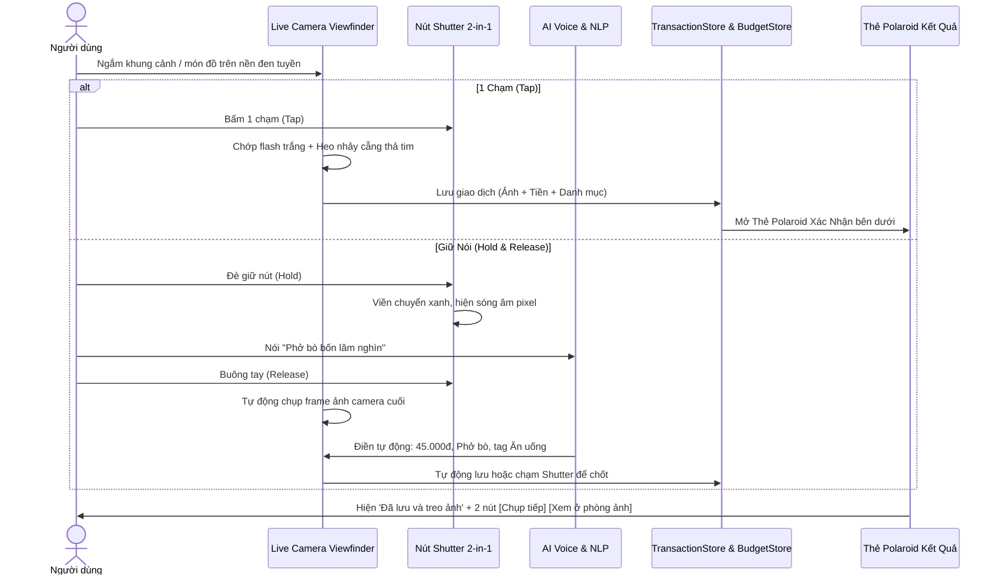

# 📷 09 — CAMERA: TAB CHỤP TỐI GIẢN ADIDAS PIXEL ART HỘI AN (PROTOTYPE 1:1)

> **Screen-unit:** Tab 2 (Camera). **Tối giản tuyệt đối, phong cách Adidas Pixel Art Hội An** dựa trên `prototype/Ví Heo Con_new_19_11.html` (Quyết định 131).
> **Điểm nhấn thiết kế:**
> - Toàn bộ nền bao quanh khung ảnh chuyển thành **Đen tuyền sâu (`#0D0D0D` - `#121212`)** tương phản mạnh mẽ.
> - Bỏ toàn bộ các chi tiết decor rườm rà (bầu trời mây nắng cũ, background loang lổ).
> - Khung ngắm Live Expo Camera thật 100% bọc trong viền Nâu Mực, 4 góc ngắm pixel trắng, chấm đỏ REC, tem ngày tháng pixel retro và heo con góc khung hình.
> - Nút Shutter tròn to 84×84px viền đa tầng Đỏ Đèn Lồng Hội An & Vàng Nghệ (`box-shadow: 0 0 0 5px #F4B93B, 0 0 0 8px #2B2118, 0 8px 0 8px #2B2118`).
> - Thẻ Polaroid Xác Nhận Kết Quả 1:1 prototype ('Đã lưu và treo ảnh' + 2 nút 'Chụp tiếp' / 'Xem ở phòng ảnh').

---

## 1. Bố Cục & Ngôn Ngữ Thiết Kế (Minimalist Black + Adidas Pixel Hội An)

| Thành Phần | Quy Chuẩn Thiết Kế | Chi Tiết Kỹ Thuật |
|---|---|---|
| **Nền Tab Camera** | Đen tuyền sâu `#0D0D0D` | Triệt tiêu mọi sao nhãng thị giác, dồn toàn bộ sự chú ý vào khung ngắm camera và nút chụp. |
| **Thanh Segment [Chi \| Thu]** | `.camseg` | 2 nút pill viền 2.5px mực, nút Chi chọn màu mực `#2B2118`, nút Thu chọn màu xanh `#5E9A57`. |
| **Khung Ngắm Live Camera** | `.scene.camwrap` | Tỷ lệ thoáng đãng, bọc trong viền 3px Nâu Mực `#2B2118`, bo góc 24px, 4 góc ngắm pixel trắng `[[8,8],[148,8],[8,120],[148,120]]`, chấm đỏ REC nhấp nháy, tem ngày retro `YY.MM.DD`. |
| **Heo Con Góc Khung Hình** | Mascot Sleep / Happy | Chú heo nằm ngủ ngoan góc khung hình (`pose: 'sleep'`), khi chụp/nói nhảy cẫng lên và thả tim đỏ. |
| **Ô Nhập Mô Tả Nổi** | `.camdesc` | Nằm sát đáy bên trong khung hình (cách đáy 10px), pill 999px nền kem bán trong suốt `#FFFBF1` viền 2.5px mực. Hoàn toàn không bị bàn phím che lấp. |
| **Cụm Nhập Số Tiền** | `.camamt` & `.amtbox` | Nhãn overline `SỐ TIỀN`, bộ số Baloo 2 `tabular-nums` to rõ, nút `[-]` và `[+]` bước nhảy 5.000đ (hoặc 500.000đ khi Thu). |
| **Dải Tag Danh Mục** | `.camtags` & `.tg` | Dải chip cuộn ngang, icon pixel 5×5 + Tên danh mục, khi chọn bừng nền Hồng Heo `#F9B8C4` / Vàng Hội An viền 2.5px mực. |
| **Nút Shutter 2-in-1** | `.shutter` | Kích thước 84×84px, viền 4px mực, nền Đỏ Đèn Lồng `#E0452B`, vòng đệm Vàng Nghệ `#F4B93B` 5px và viền ngoài 8px mực đổ bóng cứng 8px. |
| **Thẻ Polaroid Xác Nhận** | `.polar` | Thẻ ảnh nghiêng −3°, thumbnail ảnh vuông 72×72px, tiêu đề `Đã lưu và treo ảnh` + 2 nút `[ Chụp tiếp ]` và `[ Xem ở phòng ảnh ]`. |

---

## 2. Luồng Tương Tác Cốt Lõi (Interaction Flow)

---

## 3. Tiêu Chí Nghiệm Thu (AC)
- [ ] Nền toàn bộ Tab Camera là nền đen tuyền sâu `#0D0D0D` (hoặc `#121212`), không còn bầu trời mây nắng cũ.
- [ ] Khung ngắm Live Camera chân thực, có 4 góc ngắm pixel trắng, chấm REC đỏ, tem ngày `YY.MM.DD`, chú heo ngủ góc khung.
- [ ] Ô nhập mô tả dạng pill mini nằm sát đáy bên trong khung hình (chống bàn phím che).
- [ ] Cụm số tiền to rõ với 2 nút `[-]` và `[+]`, dải tag danh mục pixel `.tg`.
- [ ] Nút Shutter to tròn 84×84px viền đa tầng Đỏ Đèn Lồng & Vàng Nghệ Hội An (chạm chụp / giữ nói).
- [ ] Thẻ Polaroid Xác Nhận xuất hiện sau khi chụp/lưu đúng chuẩn prototype (`Đã lưu và treo ảnh` + `Chụp tiếp` / `Xem ở phòng ảnh`).
- [ ] Chạy 100% offline, EXIF sạch, Zero-STK.

---

## 4. Lịch Sử Tiến Hóa & Thành Phần Kế Thừa (Architecture History)
- **v1.0 - v3.0:** Khởi nguyên với `PiggyCameraRoof` (chú heo nằm trên nóc), `PolaroidReviewCard` (thẻ review ảnh chụp) và kiến trúc Khung Ngắm Thống Nhất Cố Định (Unified Fixed Frame).
- **v4.0:** Giai đoạn Dreamy Pixel Sky (bầu trời mây nắng) kết hợp thanh nhập mô tả In-Frame Bottom Pill và Snap-on-Release Voice.
- **v5.0 (Hiện tại - Quyết định 131):** Nâng cấp lên `ViewfinderCornerMascot` (chú heo ngủ và 4 góc pixel nằm trực tiếp bên trong live viewfinder), `PolaroidConfirmCard` (thẻ kết quả xác nhận 1:1 prototype `Ví Heo Con_new_19_11.html`), thanh `camDescPillInside` và `InFrameReviewOverlay` tối giản trên nền đen tuyền Adidas Pixel Art Hội An.
