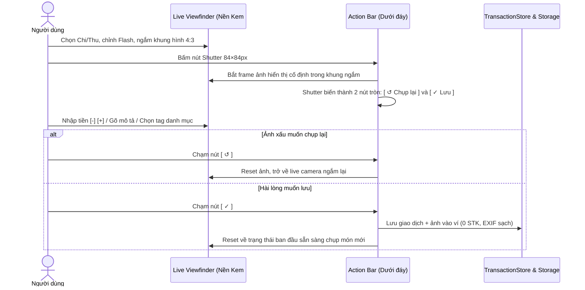

# 📷 09 — CAMERA: TAB CHỤP TINH GỌN 1:1 PROTOTYPE VÍ HEO CON (NỀN KEM #F6EEDC & LUỒNG CHỤP -> LƯU/CHỤP LẠI)

> **Screen-unit:** Tab 2 (Camera). **Chuẩn 1:1 prototype `prototype/Ví Heo Con_new_19_11.html`** (Quyết định 132).
> **Trọng tâm tinh gọn & luồng tương tác đã chốt:**
> - **Tone màu nền:** Chuyển sang màu **Kem Sàn Neo-Brutalist `#F6EEDC`** ấm áp, loại bỏ nền đen tối.
> - **Header tinh gọn:** Nút Bật/Tắt Flash + **2 nút to bản dàn đều `[ Chi ]` và `[ Thu ]`** bo tròn 999px viền 3px mực. Không nút chuông, không gallery, không pill "Hôm nay chi".
> - **Khung ngắm rộng rãi (Tỷ lệ 4:3):** Mở rộng chiều cao khung ảnh (~295px), bỏ tem ngày tháng `YY.MM.DD`, ô `Ghi mô tả` nền trắng sữa mờ viền 2px phẳng không viền đệm card rườm rà.
> - **Luồng Chụp & Nhập Thông Tin:**
>   1. Chọn Chi / Thu $\rightarrow$ Bật/Tắt Flash (nếu cần).
>   2. Bấm Shutter để chụp ảnh (ảnh hiện ngay trong khung ngắm).
>   3. Nhập số tiền trong ô `[-] [0 đ] [+]`, ghi mô tả trong khung, chọn tag danh mục (lưới 2 hàng).
>   4. Nút Shutter được thay thế bằng **2 nút tròn to ngang hàng `[ ↺ ]` (Chụp lại nếu xấu) và `[ ✓ ]` (Lưu vào ví)**.
>   5. **Tuyệt đối KHÔNG có nút "Xem ở phòng ảnh".**
> - **Lịch sử ảnh cuộn xuống:** Cuộn xuống dòng khoảnh khắc: **Một ảnh - một khung hình**, sắp xếp từ gần nhất về các giờ/ngày trước đó.

---

## 1. Bố Cục & Ngôn Ngữ Thiết Kế (1:1 Prototype Image 4)

| Khối Giao Diện | Class / Token Prototype | Đặc Tả Chi Tiết RN |
| :--- | :--- | :--- |
| **Nền Toàn Màn Hình** | `var(--bg)` `#F6EEDC` | Nền Kem Sàn thương hiệu, dịu mắt, hòa quyện đồng nhất với Tab Home và toàn bộ Design System. |
| **Header Phân Loại & Flash** | `.camseg` & `.btn` | Nút Flash góc trái + 2 nút gạt `[ Chi ]` và `[ Thu ]` dàn đều. `Chi` active đỏ `#E0452B`, `Thu` active xanh `#5E9A57`. |
| **Khung Ngắm Live Viewfinder** | `.scene.camwrap` | Kích thước `width: SCREEN_WIDTH - 24`, `height: 295` (tỷ lệ 4:3 rộng thoáng). 4 góc ngắm pixel trắng, chú heo ngủ góc, **0 hiển thị ngày tháng**. |
| **Ô Nhập Mô Tả Nổi** | `.camdesc` | Bo pill 999px, nền `rgba(255,251,241,0.92)`, viền 2px mực phẳng sát đáy khung hình (chống bàn phím che lấp). |
| **Bộ Đếm Số Tiền** | `.camamt` & `.amtbox` | Nhãn `SỐ TIỀN`, 2 nút tròn `[-]` và `[+]` 44px viền 3px mực, ô hiển thị số tiền to rõ 56px với bóng cứng 3px mực. |
| **Lưới Danh Mục 2 Hàng** | `.camtags` & `.tg` | Dải thẻ danh mục dạng flex wrap 2 hàng bo 999px, icon pixel 5×5 + Tên danh mục, active bừng Hồng Heo `#F9B8C4`. |
| **Action Bar Trước Khi Chụp** | `.camshoot` | Nút Shutter to tròn 84×84px Hội An (chạm chụp / giữ nói), kèm nút lật cam và chọn ảnh thư viện. |
| **Action Bar Sau Khi Chụp** | 2 Nút Thay Thế Shutter | **2 nút tròn to ngang hàng `[ ↺ ]` (Chụp lại) và `[ ✓ ]` (Lưu vào ví)**, viền 3px mực, 100% không bị Bottom TabBar che lấp. |
| **Lịch Sử Cuộn Xuống** | Locket Feed | **1 ảnh - 1 khung hình**, snap paging từ ảnh gần nhất về các giờ/ngày trước. |

---

## 2. Luồng Tương Tác Cốt Lõi (Core Camera Workflow)

---

## 3. Tiêu Chí Nghiệm Thu (AC)
- [ ] Nền toàn bộ Tab Camera là nền Kem Sàn `#F6EEDC`, bỏ hoàn toàn nền đen tối.
- [ ] Header có nút Flash và 2 nút to bản `[ Chi ]` và `[ Thu ]`. Bỏ chuông, gallery, pill "Hôm nay chi", không có nút "Xem ở phòng ảnh".
- [ ] Khung ngắm cao rộng thoáng đãng tỷ lệ 4:3 (~295px), bỏ tem ngày tháng retro.
- [ ] Ô nhập mô tả dạng pill phẳng không bị lồng card bo rườm rà.
- [ ] Sau khi chụp ảnh: Nút Shutter chuyển thành 2 nút tròn ngang hàng `[ ↺ ]` (Chụp lại) và `[ ✓ ]` (Lưu vào ví).
- [ ] Dải tag danh mục dàn lưới 2 hàng chuẩn prototype.
- [ ] Lịch sử cuộn xuống: 1 ảnh - 1 khung hình đi từ gần nhất về trước đó.
- [ ] Chạy 100% offline, EXIF sạch, Zero-STK, pass 100% tests.

---

## 4. Lịch Sử Tiến Hóa & Thành Phần Kế Thừa (Architecture History)
- **v1.0 - v3.0:** Khởi nguyên với `PiggyCameraRoof` (chú heo nằm trên nóc), `PolaroidReviewCard` (thẻ review ảnh chụp), cơ chế IN-FRAME REVIEW (`InFrameReviewOverlay`), nút Shutter 2-in-1 (chạm chụp / giữ nói) và kiến trúc Khung Ngắm Thống Nhất Cố Định (Unified Fixed Frame).
- **v4.0:** Giai đoạn Dreamy Pixel Sky (bầu trời mây nắng) kết hợp thanh nhập mô tả In-Frame Bottom Pill và Snap-on-Release Voice.
- **v5.0 (Quyết định 131):** Giai đoạn đen tuyền tối giản Adidas Pixel Art Hội An.
- **v6.0 (Hiện tại - Quyết định 132):** Tinh gọn 1:1 Prototype: Nền Kem Sàn `#F6EEDC`, Header Chi/Thu + Flash, khung ảnh 4:3 rộng thoáng, bỏ ngày tháng trong khung, danh mục 2 hàng, chụp xong hiện 2 nút tròn `[ ↺ ]` và `[ ✓ ]` thay thế Shutter, cuộn xuống 1 ảnh - 1 khung hình.

