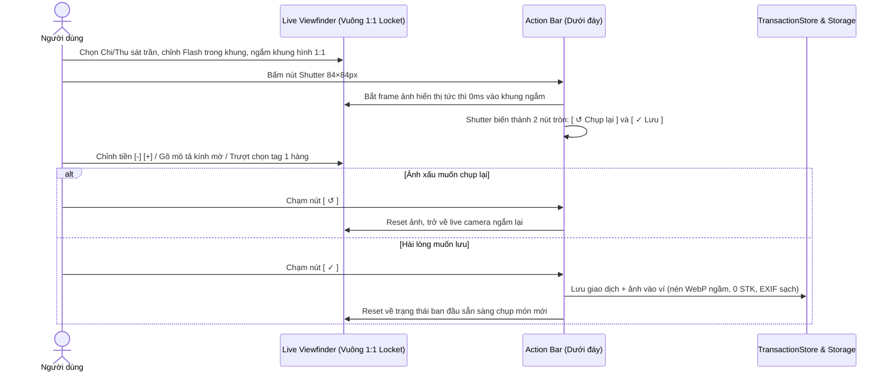

# 📷 09 — CAMERA: TAB CHỤP LOCKET 1:1 VUÔNG & TỐI GIẢN TỨC THÌ (Quyết định 133)

> **Screen-unit:** Tab 2 (Camera). **Chuẩn tỷ lệ vuông 1:1 Locket & Zero-Latency Capture** (Quyết định 133).
> **Trọng tâm tinh gọn & luồng tương tác đã chốt:**
> - **Header đụng sát trần:** 2 nút to bản dàn đều `[ Chi ]` và `[ Thu ]` áp sát mép trên status bar như prototype, không bị thụt lùi.
> - **Nút Flash nổi trần trong khung:** Nút Bật/Tắt Flash bỏ viền bo hộp thô, đặt tại góc trên bên trái bên trong khung ngắm (`top: 12, left: 12`).
> - **Khung ngắm vuông 1:1 chuẩn Locket:** Kích thước `width = height = Math.min(SCREEN_WIDTH - 24, 350)` bo góc 24px. Bỏ chấm đỏ chớp REC, bỏ 4 góc vuông `L`, giữ lại chú heo pixel ngủ góc trên bên phải.
> - **Ô "Ghi mô tả" kính mờ tối trong suốt:** Dạng viên thuốc pill 999px, nền `rgba(0, 0, 0, 0.42)`, viền mờ `rgba(255, 255, 255, 0.28)`, chữ và placeholder `#FFFBF1` sát đáy khung hình: vừa đọc rõ chữ vừa không che lấp chi tiết ảnh chụp.
> - **Cụm số tiền nền trơn:** Bỏ chữ "SỐ TIỀN", bỏ nền trắng và bóng đổ, chỉ còn `[-]`, số tiền to rõ, và `[+]`.
> - **Dải tag danh mục 1 hàng trượt ngang:** Chuyển thành `ScrollView horizontal`, tăng font chữ lên 14px và padding thoáng để chạm nhanh.
> - **Chụp - Ghi - Lưu tức thì (0ms latency):** Khi chụp xong, gán ngay `photo.uri` hiển thị lập tức không chờ nén, chuyển nén WebP dual-res sang chạy nền.
> - **Bỏ dòng chữ hướng dẫn:** Bỏ dòng `Chạm [✓] để lưu vào ví...` bên dưới 2 nút tròn.
> - **2 Nút tròn thay thế Shutter:** `[ ↺ ]` (Chụp lại) và `[ ✓ ]` (Lưu vào ví).

---

## 1. Bố Cục & Ngôn Ngữ Thiết Kế (Chuẩn Locket 1:1)

| Khối Giao Diện | Class / Token Prototype | Đặc Tả Chi Tiết RN |
| :--- | :--- | :--- |
| **Nền Toàn Màn Hình** | `var(--bg)` `#F6EEDC` | Nền Kem Sàn thương hiệu, dịu mắt, hòa quyện đồng nhất với Tab Home. |
| **Header Sát Trần** | `.camseg` & `.btn` | 2 nút gạt `[ Chi ]` và `[ Thu ]` áp sát trần (`paddingTop: Math.max(insets.top, 8)`). |
| **Nút Flash Trong Khung** | Floating Icon | Nằm ở góc trên trái trong khung ngắm (`top: 12, left: 12`), borderless, icon vector nổi trần. |
| **Khung Ngắm Locket 1:1** | `.scene.camwrap` | Kích thước vuông `348×348px` (tối đa 350px). Giữ chú heo ngủ pixel, bỏ chấm đỏ REC và 4 góc vuông. |
| **Ô Nhập Mô Tả Nổi** | Glassy Pill | Bo pill 999px, nền kính mờ `rgba(0,0,0,0.42)`, viền `rgba(255,255,255,0.28)`, chữ trắng `#FFFBF1`. |
| **Bộ Đếm Số Tiền** | Flat Amount | Bỏ nhãn `SỐ TIỀN`, nền trơn trong suốt, 2 nút tròn `[-]` và `[+]` 44px viền 3px mực. |
| **Dải Tag Danh Mục 1 Hàng** | `.camtags` horizontal | Cuộn ngang mượt mà, font 14px to rõ, active bừng Hồng Heo `#F9B8C4`. |
| **Action Bar Trước Khi Chụp** | `.camshoot` | Nút Shutter to tròn 84×84px Hội An (chạm chụp / giữ nói), kèm nút lật cam và chọn ảnh thư viện. |
| **Action Bar Sau Khi Chụp** | 2 Nút Thay Thế Shutter | **2 nút tròn to ngang hàng `[ ↺ ]` (Chụp lại) và `[ ✓ ]` (Lưu vào ví)**, bỏ dòng hướng dẫn thừa. |
| **Lịch Sử Cuộn Xuống** | Locket Feed | **1 ảnh - 1 khung hình**, snap paging từ ảnh gần nhất về các giờ/ngày trước. |

---

## 2. Luồng Tương Tác Cốt Lõi (Core Camera Workflow)

---

## 3. Tiêu Chí Nghiệm Thu (AC)
- [ ] Nút `[ Chi ]` và `[ Thu ]` áp sát trần status bar.
- [ ] Nút Flash nằm trong khung ảnh góc trên trái, không viền bo hộp.
- [ ] Khung ngắm vuông 1:1 chuẩn Locket (~350×350px), bỏ chấm đỏ REC và 4 góc vuông, giữ heo ngủ góc.
- [ ] Ô nhập mô tả dạng pill kính mờ tối trong suốt `rgba(0,0,0,0.42)`, chữ trắng tinh, không che ảnh.
- [ ] Cụm số tiền nền trơn, bỏ chữ "SỐ TIỀN".
- [ ] Dải tag danh mục 1 hàng cuộn ngang mượt mà, chữ to 14px dễ đọc.
- [ ] Chụp ảnh chuyển trạng thái tức thì 0ms, không bị khựng 1-2s.
- [ ] Bỏ dòng chữ hướng dẫn dưới 2 nút tròn.
- [ ] Chạy 100% offline, EXIF sạch, Zero-STK, pass 100% tests.

---

## 4. Lịch Sử Tiến Hóa & Thành Phần Kế Thừa (Architecture History)
- **v1.0 - v3.0:** Khởi nguyên với `PiggyCameraRoof` (chú heo nằm trên nóc), `PolaroidReviewCard` (thẻ review ảnh chụp), cơ chế IN-FRAME REVIEW (`InFrameReviewOverlay`), nút Shutter 2-in-1 (chạm chụp / giữ nói) và kiến trúc Khung Ngắm Thống Nhất Cố Định (Unified Fixed Frame).
- **v4.0:** Giai đoạn Dreamy Pixel Sky (bầu trời mây nắng) kết hợp thanh nhập mô tả In-Frame Bottom Pill và Snap-on-Release Voice.
- **v5.0 (Quyết định 131):** Giai đoạn đen tuyền tối giản Adidas Pixel Art Hội An.
- **v6.0 (Quyết định 132):** Tinh gọn 1:1 Prototype: Nền Kem Sàn `#F6EEDC`, Header Chi/Thu + Flash, khung ảnh 4:3 rộng thoáng, bỏ ngày tháng trong khung, danh mục 2 hàng, chụp xong hiện 2 nút tròn `[ ↺ ]` và `[ ✓ ]` thay thế Shutter, cuộn xuống 1 ảnh - 1 khung hình.
- **v7.0 (Quyết định 133):** Khung vuông 1:1 chuẩn Locket (348×348px), Chi/Thu sát trần, Flash nổi trần trong khung, mô tả kính mờ tối trong suốt, số tiền nền trơn, tag 1 hàng trượt ngang chữ to, chụp tức thì 0ms latency.
- **v8.0 (Quyết định 134):** Hoàn thiện luồng nhập tiền & tag trước/sau khi chụp không bị reset; Cute Toast tự ẩn sau 1.8s; Lịch sử 100vh 1 ảnh 1 khung hình snap paging; Thẻ lịch sử: mô tả kính mờ trong ảnh sát đáy, tên danh mục tiếng Việt có dấu chuẩn bên ngoài.
- **v9.0 (Quyết định 135):** Khóa tĩnh khung hình chụp 0ms (Seamless Freeze-Frame): Giữ nguyên `CameraView` không unmount, phủ ảnh tĩnh `ExpoImage` tức thì (`transition: 0`, `priority: high`), không swap URI khi nén WebP ngầm để triệt tiêu 100% cảm giác đè khung/chuyển động; Nâng cấp Ô mô tả tự co giãn (Auto-Expanding Glassy Pill) căn giữa đáy ảnh, ngắn gọn ~110px, nền kính mỏng nhẹ `rgba(0,0,0,0.22)`, tự giãn đều sang 2 bên khi gõ chữ.
- **v10.0 (Hiện tại - Quyết định 136):** Tự động Mirror Selfie: Khi `cameraFacing === 'front'`, tự động lật ảnh ngang qua `FlipType.Horizontal` để ảnh chụp ra giống 100% hình ảnh trong gương khi ngắm; Đồng bộ tone nền Tab Camera theo `tokens.bg` động từ theme (trong Theme Hồng Heo là hồng pastel `#FFF5F7` dâu sữa dịu mát).

